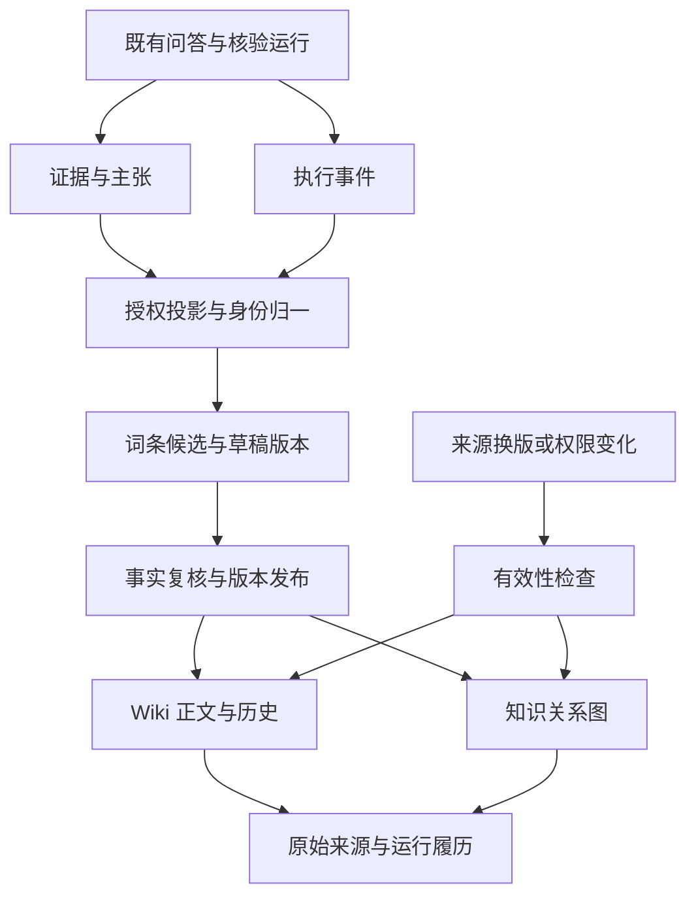

# 证据与轨迹驱动的 Wiki 知识图谱实施计划

日期：2026-10-12（Asia/Shanghai）  
状态：规划草案；本文中的新增模块、表、接口与页面均尚未实现。  
目标：把问答产生的证据与执行轨迹沉淀为可阅读、可关联、可追溯、可持续修订的知识 Wiki。

## 1. 产品目标与使用路径

Wiki 承载整理后的知识，图谱表达知识之间的关系，证据与轨迹解释知识的依据和形成过程。

用户应能完成以下路径：

1. 完成一次问答或核验，在答案附近点击“整理为知识词条”。
2. 系统生成带引用的草稿，并提示可关联的现有词条。
3. 用户查看来源、修订正文、复核事实；具备发布权限者发布指定版本。
4. 进入 Wiki 关系图，在当前授权范围内浏览、搜索和筛选词条，探索关联设备、指标、规范和结论。
5. 点击圆点节点选中词条，在详情区阅读正文；切换来源证据或运行轨迹图层，定位原文或数据记录，再展开执行事件时间线。
6. 来源换版后，看到“待重新核验”提示，并能查看旧版本与重新核验结果。

示例词条：“设备 A 的温度要求”。它关联设备 A、适用规范、温度指标、测量记录和核验结论。所有示例数据须标注演示属性。

## 2. 现有基础与待补能力

以下现状来自本次代码检查；实施时应再次核对当前检出。

| 现有能力 | 代码或契约 | 可复用部分 | 待补能力 |
| --- | --- | --- | --- |
| 类型化证据图 | `datamind/evidence_graph.py` | 节点、关系、来源摘要、绑定字段、冲突检测 | 跨运行身份与 Wiki 投影 |
| 主张与核验 | `datamind/cross_source.py`、`datamind/agent.py` | 主张引用证据，保留核验范围 | Wiki 审核与发布状态 |
| 运行、事件、证据查询 | `datamind/api.py` 的 `/v1/runs/*` | 按运行读取数据 | 面向 Wiki 的授权查询与关联查询 |
| 图谱与详情展示 | `frontend/src/components/stargraph/` | 交互逻辑参考、证据详情、来源定位 | 新增自由分布的力导向 Wiki 图，词条目录、正文与历史 |
| 会话归属 | `datamind/sessions.py`、[会话契约](SESSIONS.md) | 用户归属、软删除、问答分组 | Wiki 与运行的独立关联及保留策略 |
| 认证与来源可见性 | `datamind/auth.py`、`datamind/visibility.py` | 登录态、角色、CSRF、来源发布判定 | 词条、引用、图谱和搜索的权限闭包 |
| 私有 PDF 版本 | [私有 PDF 发布契约](PDF_KNOWLEDGE_PUBLICATION.md) | 固定 publication、快照、定位及完整性验证 | 在原有权限内引用特定历史版本 |

需要明确的现状边界：

- `evidence_graph.make_node()` 把 `run_ref` 纳入身份，同一来源在不同运行中的节点可能有不同 ID；Wiki 需要独立的长期身份。
- 跨源主张的 `verified` 包含“绑定完整且运行完成”的判断，核验载荷同时记录 `full_semantic_entailment=not_independently_verified`。此状态不能直接映射成 Wiki 的事实已确认。
- 当前证据图持久化写入边端点和类型，未完整落库边的理由、置信度与绑定类型。新投影应保存这些信息；历史缺失的信息标注缺失。
- 前端节点类型与类型化图模块存在不同词表，投影层需要显式适配，未知类型保留原始类型并标注未支持。
- `/v1/runs` 位于当前匿名读取前缀中；Wiki 必须自行校验运行归属和来源权限，不能把已有运行接口的可读性当作授权依据。

## 3. 第一版范围与设计约束

### 3.1 第一版交付

- 按当前用户归属的私有 Wiki 空间；空间键先对应用户，暂不提供团队空间管理。
- 四类词条：业务实体、指标、规范、分析结论；目录分类与别名搜索。
- 从显式选择的运行生成候选草稿，也支持人工编辑带引用的正文。
- 同一词条关联多次运行的证据，保留每次运行的独立履历。
- 以力导向关系图为 Wiki 入口；点击节点查看正文，词条深链直接进入正文；支持来源证据与运行轨迹图层、事件时间线和版本历史。
- 发布指定版本、冲突展示、来源变更后的待核验提示。
- Markdown 导出，保留知识状态、引用、来源版本和运行标识。

### 3.2 后续扩展

团队协作、公开发布、语义搜索、多跳图谱问答、自动批量整理和外部 Wiki 同步在第一版验收后单独规划。第一版使用现有 PostgreSQL 承载知识与关系，避免提前引入新的图数据库或向量链路。

### 3.3 核心约束

- 既有运行、证据与轨迹继续保存；Wiki 通过引用和不可变快照关联它们。
- 自动生成内容进入草稿；发布与事实核验分别记账。
- 名称相近只能产生合并建议，只有业务标识、已批准别名或人工确认才允许实体归并。
- 相同事实的重复引用可归并，来源、版本、时间范围或记录对象不同的证据保留差异。
- 冲突保留双方值、来源和裁决依据；排序、检索得分和模型置信度不决定权威。
- 轨迹展示已有执行事件、输入输出摘要与错误信息；不生成或保存模型隐藏思维过程。
- 每项可见内容都满足空间、运行和来源权限，摘要、搜索结果、节点计数同样执行该规则。

## 4. 总体架构

新增知识服务负责投影、词条、版本、审核和权限。问答完成后只提供整理入口；整理失败可重试，不影响原问答结果。

## 5. 数据模型与身份规则

以下表名为建议，迁移编号在实施时按仓库现有顺序分配。

| 建议表 | 职责 | 关键字段或约束 |
| --- | --- | --- |
| `wiki_entries` | 词条长期身份与当前发布头 | `entry_id`、`space_id`、`owner_id`、类型、业务键、`head_revision_id`、归档时间 |
| `wiki_revisions` | 不可变正文版本 | `revision_id`、`entry_id`、基线版本、标题与正文快照、引用清单、作者、生成方式 |
| `wiki_assertions` | 版本内的结构化主张 | 所属版本、实体、指标、原始值、规范值、单位、时间范围、适用版本、证据引用 |
| `wiki_evidence_refs` | 可复用的来源版本与定位快照 | 空间、证据指纹、来源标识、快照或 publication、哈希、页块或记录定位、原始内容 |
| `wiki_provenance_links` | 知识与运行中证据出现记录的映射 | 版本或主张、证据引用、`run_id`、`evidence_id`、`claim_id`、事件引用 |
| `wiki_relations` | 知识关系与依据快照 | 所属版本、两端词条或主张、关系类型、引用、原始边类型、理由、规则版本 |
| `wiki_review_events` | 追加式复核与发布记录 | 目标版本、动作、操作者、依据、时间、审核范围、预期旧发布头 |
| `wiki_build_jobs` | 整理请求的幂等与恢复 | owner、请求 ID、规范请求摘要、目标运行、状态、错误、结果版本 |

### 5.1 三类身份

1. **词条身份**：优先使用空间内的业务命名空间与实体键；缺少可靠实体键时分配 ID，保留待确认标识。标题变更不改变身份。
2. **证据身份**：指纹包含空间、来源身份、来源版本或快照、定位与原始内容摘要。SQL 证据还包含查询口径、数据快照与行或聚合范围；来源快照缺失时保持运行隔离。
3. **主张比较身份**：按实体、指标或谓词、适用版本、时间范围、具名记录与统计口径建立比较组，具体值分别存储。指标相同但时间或口径不同的主张不直接判为冲突。

继续使用原 `evidence_id` 表示一次运行中的证据出现记录；新增证据指纹通过 provenance 映射关联所有出现记录。不同用户的私有空间分别归一，避免跨空间存在性泄露。

### 5.2 版本与关系

- 新编辑创建新版本，并显式携带基线版本；已保存版本的正文与引用不可原地覆盖。
- 主张、引用与关系均绑定版本。读取历史版本时同时返回该版本的关系和核验记录。
- 发布头必须指向同一词条的版本；发布采用比较并交换（CAS），过时基线返回冲突。
- 人工调整数值、引用、单位、适用范围或关系依据后，创建新版本并重新核验。
- 新运行投影保存完整边元数据；历史缺失边理由时记录 `provenance_incomplete`，不得推测补全。
- 历史来源定位显式绑定旧版本，禁止静默跳转到最新文档或最新 SQL 数据。

## 6. 知识状态、复核与来源变更

发布状态与知识有效性采用独立维度，避免“已发布”被误解成“已证实”。

| 维度 | 建议状态 | 含义 |
| --- | --- | --- |
| 发布流程 | `draft`、`in_review`、`published`、`archived` | 是否完成指定版本的编辑与发布流程 |
| 主张核验 | `unverified`、`verified`、`insufficient`、`conflicted` | 在明确核验范围内，证据是否支撑主张 |
| 来源有效性 | `current`、`stale`、`unavailable` | 本次检查时的版本适用性及可访问性 |

实施要求：

- `verified` 必须记录核验对象、方法、覆盖范围、规则版本、操作者和时间。
- 来源完整性、实体绑定、规则核验、语义支持、来源权威分别记录，不互相替代。
- 允许发布“存在冲突”的说明词条，但冲突主张始终显示双方依据，不能显示为已确认结论。
- 编辑或发布均不能自动激活来源权威规则；相关规则继续使用既有登记和审批机制。
- 通过来源到主张、版本的反向索引定位换版影响；登记变更事件，并在读取时复查有效性。
- 新来源产生新证据引用和新候选版本；旧来源快照与旧结论保留，当前视图提示待核验。
- 来源被撤权或删除后，读取即时过滤受限内容；内部保留审计记录，用户侧只显示权限允许的状态提示。
- 软删除会话不删除运行；已发布 Wiki 引用的运行和来源不得经普通清理任务级联销毁，专门删除流程另行定义。

## 7. 拟新增 API 与权限契约

所有 `/v1/wiki/*` 接口要求有效身份、空间归属和来源权限；写操作复用同源与 CSRF 校验，在写事务中复查并锁定当前身份；长时间构建后的提交和返回前再次校验权限。私有响应使用 `Cache-Control: no-store`。首次实现不加入匿名读取例外。

| 接口 | 作用 | 建议权限 |
| --- | --- | --- |
| `GET /v1/wiki/entries?q=&type=&status=&limit=&cursor=` | 授权词条目录与关键词搜索 | 任意有效身份，限可访问空间 |
| `GET /v1/wiki/spaces/{space_id}/graph?layer=&q=&type=&category=&status=&limit=&cursor=` | 当前授权范围图，默认词条图层；分页返回节点与关系 | 任意有效身份，并校验空间、运行、来源与版本可见性 |
| `GET /v1/wiki/entries/{id}` | 当前发布版本；草稿需编辑权限 | 同上，并校验版本可见性 |
| `GET /v1/wiki/entries/{id}/revisions` | 可见版本历史 | 同上 |
| `GET /v1/wiki/entries/{id}/revisions/{revision_id}` | 固定版本详情 | 同上 |
| `GET /v1/wiki/entries/{id}/graph?depth=&limit=` | 授权关系邻域 | 同上，返回截断标识 |
| `GET /v1/wiki/entries/{id}/provenance?revision_id=&cursor=` | 固定版本的证据与执行事件摘要 | 同上，再校验运行与来源权限 |
| `GET /v1/wiki/entries/{id}/export?revision_id=` | 带状态与引用的 Markdown | 同上，使用同一授权投影 |
| `POST /v1/wiki/builds` | 从指定运行创建候选草稿 | `reviewer` 或 `admin`，且有空间与来源权限 |
| `GET /v1/wiki/builds/{id}` | 查看自己的整理任务 | 请求 owner 或具有相应管理权限者 |
| `POST /v1/wiki/builds/{id}/retry` | 原请求失败重试 | 原 owner 且当前仍有编辑权限 |
| `POST /v1/wiki/entries/{id}/revisions` | 以基线创建新版本 | `reviewer` 或 `admin`，且有空间编辑权限 |
| `POST /v1/wiki/entries/{id}/reviews` | 对指定版本追加复核结果 | `reviewer` 或 `admin`，且有空间权限 |
| `POST /v1/wiki/entries/{id}/publications` | 发布指定版本并检查旧发布头 | `approver` 或 `admin`，且有空间权限 |

角色判断以实际 `auth.py` 行为为准；不能假设 `approver` 自动拥有 `reviewer` 权限。角色门通过也不会扩大原来源的访问范围。

目录、详情、图谱、计数、历史、导出与来源展开共用授权投影；不可访问对象统一返回不存在。轨迹只返回允许可见且经过脱敏的字段，尊重 `visibility`，不返回凭据、内部绝对路径或私有执行会话载荷。

初始查询边界建议：目录默认 20、最多 50 条；空间图默认词条图层、每批 50 节点，单次显示最多 100 节点与 300 条关系；图邻域默认 1 跳、最多 2 跳，遵守同一显示上限；事件摘要每页最多 200 条。空间图返回所选图层、已加载数量、`next_cursor`、`has_more` 与 `truncated`，关系两端都必须在当前已授权且已加载节点集合内。图层或筛选条件变化时重置游标和加载集合；达到显示上限后提示缩小范围，不能通过继续加载绕过上限。

界面将空间图称为“当前授权范围图”，不得描述为全库全图；分页结果、邻域和轨迹分别标明尚有后续或已截断。节点连接数仅统计当前授权、当前图层且已加载的连接，不返回隐藏内容的总度数。关键词搜索先覆盖标题、别名与分类；中文正文检索策略通过样本验证后确定。

## 8. 前端页面方案

新增 `/#/wiki` 与 `/#/wiki/:entryId`，沿用现有 hash 路由和页面设计变量。

### 8.1 视觉基线与入口

以用户提供的参考图为视觉与交互基线：白色背景与充足留白、圆点节点及其标题、低对比度细线、自由分布的力导向布局，右上角放置紧凑的可折叠设置面板。参考图只约束呈现方式，图中标签与文件名不作为项目知识或示例数据导入。

`/#/wiki` 默认展示当前授权范围内已加载的词条关系图；搜索与替代目录保持可访问。点击节点选中词条，在侧边详情区展示正文、引用、状态与操作，并高亮该节点、邻居和相连关系。`/#/wiki/:entryId` 及固定版本深链直接展示对应词条正文，再提供返回关系图的入口；刷新深链仍保留正确的词条和版本选择。窄屏采用关系图与详情分步切换。

| 区域 | 第一版内容 |
| --- | --- |
| 关系图入口 | 白底圆点、标题、细线、自由布局；标明当前图层、已加载范围、分页与截断 |
| 替代目录 | 与当前授权图一致的搜索、分类、状态筛选、最近更新与分页，支持键盘和屏幕阅读器 |
| 词条正文 | 标题、摘要、结构化结论、引用标记、核验范围与来源状态 |
| 局部关系 | 选中词条后高亮邻域；关系详情区分支持、冲突、适用范围与相关关系 |
| 来源证据 | 原文或数据记录、来源版本、可用的页块定位与完整性状态 |
| 运行轨迹 | 图层展示与词条关联的运行，详细执行事件在时间线展开，支持继续加载 |
| 右上设置面板 | “筛选／颜色组／外观／力度”四个可折叠组，窄屏可收起整个面板 |
| 版本历史 | 固定版本阅读、正文与引用变化、复核和发布事件 |
| 编辑与发布 | 生成草稿、编辑正文、查看基线差异、复核与发布指定版本 |

### 8.2 节点、关系与图层语义

- 默认图层为词条关系；来源证据和运行轨迹作为可切换图层，切换时重新取得授权数据并保留可继续访问的选中词条。
- 圆点大小只表示当前授权且已加载的连接数，并采用有上下限的缩放；不表示置信度、权威或全库连接数。孤立节点仍可见、可点击。
- 初始节点使用深浅灰色；启用颜色组时按词条类型或分类着色，提供图例与文字说明。冲突与核验状态另以文字或标识表达，不能只靠颜色辨认。
- 细线代表实际已保存且允许访问的关系；选中后显示关系类型、方向与依据。空间距离和布局位置只用于排布，不代表语义得分、可靠性或因果关系。
- 标题默认可读，缩放后按可用空间减少非选中标签；选中节点与邻域标题优先显示，完整标题始终可在详情或替代目录读取。
- 运行图层展示运行与词条、证据的对应关系；详细事件留在真实时间顺序的时间线，不将所有事件铺到空间图中。

### 8.3 交互与四组设置

支持缩放、平移、拖拽节点、选中词条、邻域高亮、恢复视图和暂停布局。拖拽仅调整显示位置，不更改知识关系；打开详情后保持图的当前视野与选中状态。

| 折叠组 | 第一版设置 |
| --- | --- |
| 筛选 | 图层、词条类型、分类、知识状态与关键词；仅在当前授权集合内筛选 |
| 颜色组 | 按类型或分类启用颜色、显示图例、恢复默认灰色 |
| 外观 | 标题显示、圆点尺寸缩放、细线透明度、低运动与暂停／恢复布局 |
| 力度 | 排斥力、连接拉力、连接长度与向中心聚合的程度；提供有界参数与恢复默认值 |

力度只改变布局，不改变关系或审核结果。设置面板可用键盘展开、调整与折叠；图外提供可聚焦的词条目录、缩放与视图恢复按钮，确保无需拖拽或辨色也能选择词条、阅读关系和追溯来源。尊重系统低运动偏好，低运动模式使用静态或短时排布，暂停后不持续移动节点。

### 8.4 组件与布局开销

新增 `WikiForceGraph.vue` 承载力导向关系图，支持循环与多对多关系。现有 `ConstellationGraph.vue` 为分层卡片布局，可参考交互逻辑，不强行复用其布局和节点呈现。复用 `NodeDetail.vue` 的来源证据与定位详情，通过独立适配层接入 Wiki；前端类型覆盖实际返回的支持、冲突、版本与绑定关系。

初始布局边界建议：单次显示最多 100 节点与 300 条关系，迭代最多 300 次或运行 5 秒，先到边界即停止；收敛、暂停、页面隐藏或离开图视图后停止模拟。仅在节点或关系集合、布局参数变化或用户明确恢复时重新排布；缩放、平移与打开详情不触发全图重新计算。超限时采用筛选或局部邻域，显示范围说明；布局计算应避免阻塞选择、拖拽和详情交互，使用异步批次或 worker 的实现选择在 P4 样本验证后确定。

问答页新增“整理为知识词条”动作和任务状态；保存成功后链接到草稿。加载失败、无权限、无证据、引用失效、定位不可用、整理失败、版本冲突均提供明确反馈。

## 9. 分阶段实施与验收

### P0：冻结契约与样本

- [ ] 定义四类词条、关系词表、三类身份与发布/核验/有效性状态。
- [ ] 约定空间归属、各角色操作范围及运行 owner 无法确认时的拒绝规则。
- [ ] 选取文档问答、SQL 查询、跨源核验三组现有运行，另加入来源缺失、版本变化和冲突样本。
- [ ] 冻结 API、错误码、查询边界、历史读取和幂等重试契约。
- [ ] 冻结第 8 节参考图视觉基线、图层与大小语义、四组设置及布局开销边界。

**验收**：每个样本明确预期词条、引用、关系与可见范围；缺少可靠归属或来源版本时的行为没有模糊默认值。

### P1：知识存储、身份与版本

- [ ] 新建 Wiki 表和幂等迁移，保持既有证据写入兼容。
- [ ] 普通迁移由 `datamind_app` 执行，使用应用角色持有的新表与映射；不对 `postgres` 持有的 `runs`、`trace_events` 增删列、建索引或修改授权。确需修改旧表时单独制定由表 owner 执行的迁移路径。
- [ ] 实现词条归一、证据指纹、provenance 映射、不可变版本与发布头 CAS。
- [ ] 保存完整的新投影关系依据；历史缺失字段明确标记。
- [ ] 配置新表最小权限，确认 `PUBLIC`、`readonly_user` 与既有默认授权不会开放私有 Wiki 数据。

**验收**：两次运行引用同一证据时，形成一个可复用证据引用和两条运行映射；来源版本变化产生新引用；并发发布不会覆盖较新的发布头；新库与升级库迁移均可重放。

### P2：候选整理与审核服务

- [ ] 实现各来源节点类型与主张的投影适配器。
- [ ] 先通过确定性模板生成带引用草稿；模型润色作为可选步骤，保留模型与模板版本。
- [ ] 落库整理任务与请求摘要，实现相同 owner、相同请求载荷的幂等返回、失败恢复和最终权限复查。
- [ ] 实现复核、发布、冲突保留、来源换版检查与历史版本读取。

**验收**：相同请求重试不创建重复版本；改载荷复用请求 ID 被拒绝；运行失败或证据不足不会得到已核验主张；整理失败不改变原答案。

### P3：授权 API 与搜索

- [ ] 实现第 7 节接口与统一授权投影。
- [ ] 为列表、搜索、图谱、计数、历史、轨迹与导出提供一致权限过滤。
- [ ] 在 Wiki 内校验运行归属，不直接暴露匿名运行接口中的原始载荷。
- [ ] 完成关键词样本验证、当前授权范围图分页、图层切换与有界邻域查询；已加载连接数不得包含隐藏节点或未加载关系。

**验收**：用户 A 无法读取、搜索、导出或通过节点数推断用户 B 的私有内容；来源权限在整理或读取期间失效时，不返回受限内容；私有 PDF 引用继续遵守原 admin 与固定版本读取契约。

### P4：Wiki 页面与问答入口

- [ ] 按参考图实现白底留白、圆点与标题、细线和自由力导向布局，新增 `WikiForceGraph.vue`；关系图为入口，节点选择展示词条详情，词条与版本深链直接打开正文。
- [ ] 新增来源证据与运行轨迹图层、详细事件时间线、版本历史、编辑与发布界面；复用来源详情适配能力。
- [ ] 接入侧栏、问答结果动作和草稿深链。
- [ ] 实现缩放、平移、拖拽、选中词条与邻域高亮，以及右上“筛选／颜色组／外观／力度”四组折叠设置。
- [ ] 说明圆点尺寸与已加载连接数的关系，显示关系方向、依据、授权范围、分页与截断；布局距离不赋予语义含义。
- [ ] 完成替代目录、键盘操作、低运动与暂停布局；验证节点／边上限、迭代／时间上限和后台停算。
- [ ] 完成窄屏、空态、错误态、来源定位和版本冲突交互。

**验收**：Wiki 首屏符合参考图的白底圆点、细线、自由布局与右上四组折叠面板；用户能从真实问答生成草稿、复核发布，在授权关系图中搜索并选中词条，切换证据与运行图层，再定位来源和事件时间线。圆点只使用已授权且已加载连接数；继续加载不能突破节点／边上限，局部图不声称完整全图；暂停、低运动和后台停算有效。替代目录能完成相同的词条选择与追溯任务；刷新词条及历史版本深链后直接显示正确正文。

### P5：受控回填与交付

- [ ] 历史回填先 dry-run，输出明确 owner、选定运行、候选词条、无法归一项和缺失出处。
- [ ] 确认范围后分批回填候选草稿，支持检查点、重试和统计；不自动发布历史主张。
- [ ] 执行关键集成与前端验证，生成 Markdown 示例导出与验证报告。
- [ ] 提供功能开关、停用入口与回退说明；停用 Wiki 时既有问答与审计链仍可使用。

**验收**：回填可重复执行而不产生重复知识；可核对导入、跳过和失败原因；停用新入口不会破坏原运行数据。

依赖顺序：`P0 → P1 → P2 → P3 → P4 → P5`。P0 完成后，前端可并行准备页面外壳；真实数据联调依赖 P3。

## 10. 验证重点与完成标准

| 场景 | 必须证明的行为 |
| --- | --- |
| 跨运行复用 | 相同来源版本能够复用，所有运行映射保留 |
| 身份与口径差异 | 同名不同实体、不同来源版本、不同时间与统计范围不被错误合并 |
| 冲突 | 双方原值与来源可见，裁决有明确规则或审核依据 |
| 历史 | 新发布和新来源不会改变旧版本正文、引用与关系 |
| 并发与恢复 | 旧基线发布失败；相同请求可恢复且不重复写入 |
| 权限 | 所有读取面执行相同规则，撤权后不泄露受限正文、摘要、轨迹或计数 |
| 轨迹与定位 | 仅展示真实事件和已证明的定位；缺失原因可见 |
| 图谱呈现与交互 | 白底圆点细线、自由布局、四组折叠设置、节点详情与正文深链符合基线 |
| 图层与规模 | 默认词条图，来源／运行图层可切换；连接数只含已授权加载关系，分页与布局开销有界 |
| 可访问性与运动 | 替代目录与键盘可完成主要路径，低运动与暂停生效，后台不持续模拟 |
| 完整性 | 新投影关系理由保存，历史缺失不被伪造补齐 |
| 数据保留 | 会话软删除和普通清理不破坏已发布引用链 |

实现阶段针对上述风险新增有意义的服务与接口测试；按实际变更运行既有证据、绑定、会话、来源可见性和私有 PDF 回归。前端完成构建及桌面/窄屏浏览器验证。本文是计划文档，尚未执行这些功能测试。

第一版完成需满足：

- [ ] 三组真实来源场景均完成“问答 → 草稿 → 复核发布 → Wiki 阅读 → 证据/轨迹追溯”。
- [ ] 多次问答可沉淀到同一词条，且不丢失来源和运行记录。
- [ ] 冲突、证据不足、过期、权限不足与定位缺失均明确展示。
- [ ] 关系图入口、节点详情、图层切换、四组折叠设置、替代目录及有界布局通过 P4 验收。
- [ ] 权限、版本、幂等、并发和历史保留的关键验证通过。
- [ ] Markdown 导出与页面引用一致，私有源不会因导出或图谱而扩大访问范围。
- [ ] 发布接口契约、迁移说明、操作指南、回填报告与回退步骤齐备。

## 11. 预期文件与交付物

以下为实施时的建议位置，不代表已创建：

- `datamind/wiki.py`：词条、版本、授权查询与发布服务。
- `datamind/wiki_projection.py`：节点适配、来源快照、身份与跨运行映射。
- `datamind/wiki_jobs.py`：候选整理任务、幂等与恢复。
- `datamind/api.py`：新增 Wiki 路由及明确权限映射。
- `db/migrations/<next>_wiki_knowledge.sql`：知识表、索引、约束与权限。
- `frontend/src/views/WikiPage.vue`、`WikiEntryPage.vue`：关系图入口、替代目录与正文深链页面。
- `frontend/src/components/wiki/WikiForceGraph.vue`：圆点细线力导向图、图层、视野、选择与有界布局。
- `frontend/src/components/wiki/WikiGraphSettings.vue`：筛选、颜色组、外观、力度四组折叠设置。
- `frontend/src/components/wiki/`：词条详情、来源适配、事件时间线、历史与编辑组件，复用 `NodeDetail.vue` 的来源详情。
- `frontend/src/api/client.ts`、`types.ts`：同源请求与 Wiki 类型。
- `tests/test_wiki*.py`：身份、版本、投影、权限与恢复验证。
- `docs/WIKI_API.md`、`WIKI_USER_GUIDE.md`：接口与使用契约。
- `reports/wiki_*/`：受控回填与验收证据。

首个实施交付以 P0 和 P1 为界：先冻结身份、权限和版本规则，再建立可验证的知识存储。
